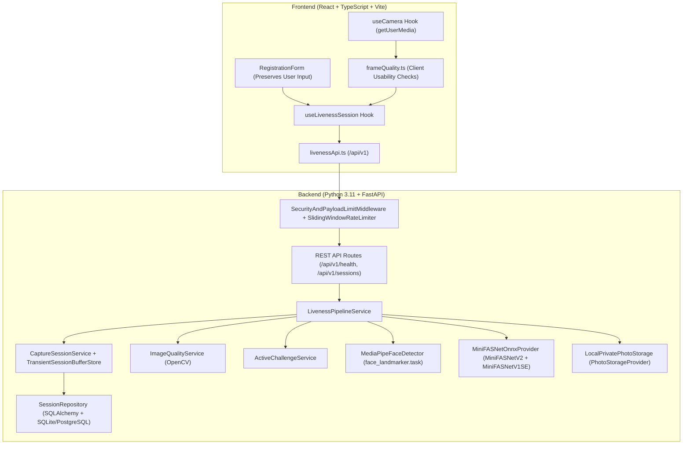
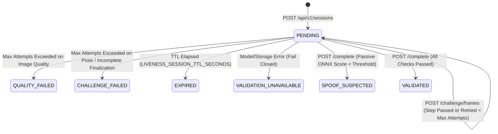

# System Architecture

## 1. High-Level Overview

The Facial Liveness Detection System is a decoupled client-server application designed to verify that a live person is physically present in front of a camera while detecting common presentation attacks (printed photographs and digital screen replays).

**Scope Boundary:** This system exclusively handles facial capture, image quality assessment, active + passive liveness validation, and secure persistence of the accepted portrait. It does **not** perform identity verification, 1:1 or 1:N face recognition, or document matching.

## 2. Backend Component Layers

1. **API Layer (`backend/app/api/`):**
   - Exposes versioned REST endpoints under `/api/v1`.
   - Enforces payload size bounds (`LIVENESS_MAX_REQUEST_BYTES`), IP rate limits (`LIVENESS_RATE_LIMIT_REQUESTS_PER_MINUTE`), and strict CORS origins.
   - Maps all exceptions to structured error envelopes (`error.code`, `error.message`, `error.details`) without leaking biometric payloads or stack traces.
2. **Capture-Session Service (`backend/app/services/capture_session.py`):**
   - Generates cryptographically random session nonces (`secrets.token_urlsafe(32)`) stored only as SHA-256 digests (`nonce_hash`).
   - Enforces progressive challenge disclosure: the client only sees the current active challenge step (`current_step_index`), preventing pre-computed replay of future challenges.
   - Manages `TransientSessionBufferStore`, keeping at most `passive_sample_frames_max` representative frames in RAM during an active session and immediately purging all arrays upon completion, failure, or expiration.
3. **Computer-Vision Providers (`backend/app/vision/`):**
   - `FaceDetectorProvider` (`MediaPipeFaceDetector`): Detects faces and extracts 478 3D landmarks + 4x4 facial transformation matrices using Google MediaPipe `face_landmarker.task`.
   - `AntiSpoofingProvider` (`MiniFASNetOnnxProvider`): Abstracted behind a clean interface (`predict_frame`, `evaluate_frames`, `is_ready`, `model_statuses`) so alternative ONNX or PyTorch PAD models can be swapped in without changing the API or session state machine.
4. **Storage & Persistence (`backend/app/storage/`, `backend/app/repositories/`):**
   - `PhotoStorageProvider` (`LocalPrivatePhotoStorage`): Re-encodes accepted portraits as clean JPEGs (stripping EXIF metadata) and writes them with 40-hex-character opaque keys outside any web-accessible directory.
   - `SessionRepository`: SQLAlchemy 2.0 ORM supporting SQLite for local development and PostgreSQL via `LIVENESS_DATABASE_URL`, with Alembic migrations in `backend/migrations/`.

## 3. Session State Transitions

All terminal states (`QUALITY_FAILED`, `CHALLENGE_FAILED`, `SPOOF_SUSPECTED`, `VALIDATION_UNAVAILABLE`, `EXPIRED`, `VALIDATED`) are immutable and one-time use. Any attempt to submit frames or re-complete a finalized session returns HTTP `409 Conflict` (`SESSION_INVALID_STATE`).
