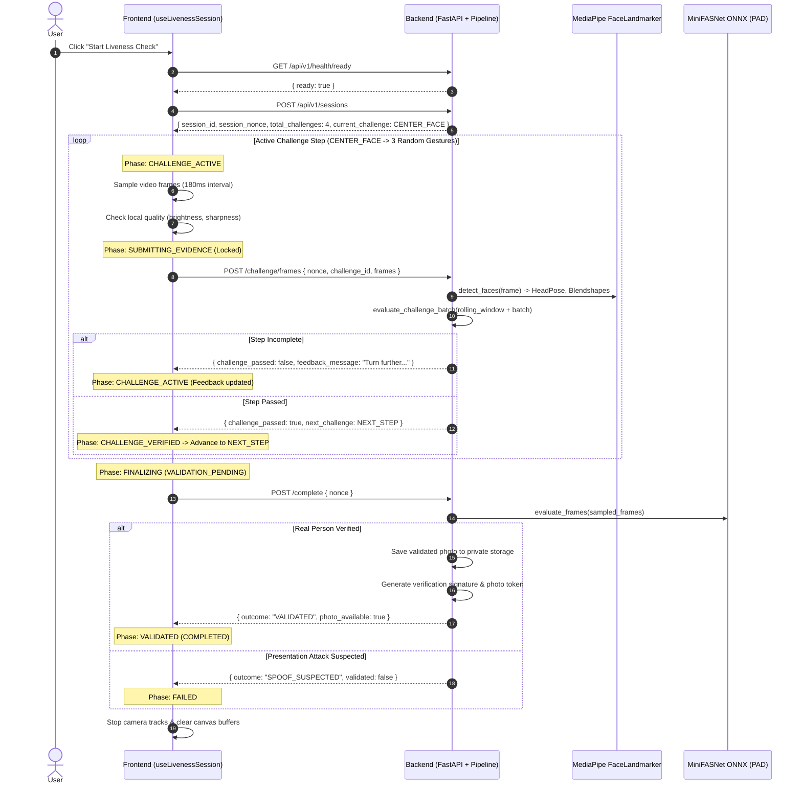

# Automatic Capture Workflow — Hybrid Architecture & State Machine Design

**Date:** 2026-10-26  
**Status:** Approved for Implementation  
**Architecture Pattern:** Pattern B — Server-Driven Incremental Detection with Client Usability Guidance  

---

## 1. Selected Hybrid Architecture: Pattern B

### 1.1 Rationale
- **Constraint Compliance:** No heavy machine learning models (e.g. `@mediapipe/tasks-vision`) are downloaded into the browser. This eliminates ~4MB of bundle bloat, avoids WebAssembly/WebGL initialization overhead, and ensures complete compatibility across desktop and mobile browsers.
- **Server Authority:** The backend remains the sole authority for evaluating 3D head poses, facial blendshapes, and passive anti-spoofing scores. The client cannot forge or declare a challenge as completed.
- **Lightweight Client Execution:** The client performs zero-dependency image usability checks (resolution, brightness, contrast/sharpness) on an offscreen HTML5 canvas to provide real-time UI guidance before and during frame transmission.
- **Continuous Sampling & Controlled Submission:** The client samples frames at a controlled interval (e.g. 180ms) and submits bounded batches (3 frames per batch) to the backend. An explicit in-flight lock ensures no concurrent requests are dispatched.

---

## 2. Capture & Verification Sequence

---

## 3. Explicit State Machine

The workflow is governed by a 12-state deterministic state machine:

| State | Description | Next Legal States |
| :--- | :--- | :--- |
| `IDLE` | Initial state. Registration form editable, camera inactive. | `INITIALIZING` |
| `INITIALIZING` | Checking model readiness, requesting `getUserMedia`, creating session. | `WAITING_FOR_FACE`, `SERVICE_UNAVAILABLE`, `ERROR` |
| `WAITING_FOR_FACE` | Camera active, verifying client-side image brightness/sharpness. | `CHALLENGE_ACTIVE`, `ERROR`, `CANCELLED` |
| `CHALLENGE_ACTIVE` | Current challenge displayed; automatic sampling timer active. | `ACTION_DETECTED`, `SUBMITTING_EVIDENCE`, `EXPIRED`, `CANCELLED` |
| `ACTION_DETECTED` | Candidate frame batch captured and ready for transmission. | `SUBMITTING_EVIDENCE`, `CANCELLED` |
| `SUBMITTING_EVIDENCE` | Request in-flight (`POST /challenge/frames`). In-flight lock engaged. | `CHALLENGE_VERIFIED`, `CHALLENGE_ACTIVE`, `FAILED`, `EXPIRED`, `ERROR` |
| `CHALLENGE_VERIFIED` | Backend verified current step; advancing to next step. | `CHALLENGE_ACTIVE`, `FINALIZING` |
| `FINALIZING` | All challenges verified; executing passive anti-spoofing verification. | `VALIDATED`, `FAILED`, `ERROR` |
| `VALIDATED` | Terminal success; physical presence confirmed, accepted photo stored. | `IDLE` (via Reset) |
| `FAILED` | Terminal failure (`SPOOF_SUSPECTED`, `CHALLENGE_FAILED`, `QUALITY_FAILED`). | `IDLE` (via Retry) |
| `EXPIRED` | Terminal failure: session TTL elapsed during capture. | `IDLE` (via Retry) |
| `CANCELLED` | User explicitly cancelled capture; all resources released. | `IDLE` |

---

## 4. API & Protocol Invariants

1. **Strict Monotonic Timestamps:** Client-provided `timestamp_ms` values must be strictly increasing. Out-of-order or duplicate timestamps result in HTTP 400 (`FRAME_ORDER_INVALID`).
2. **Cryptographic Nonce Binding:** Every frame submission and completion request must provide the `session_nonce`. Nonce mismatches result in HTTP 403 (`SESSION_NONCE_MISMATCH`).
3. **Progressive Challenge Disclosure:** The backend never reveals upcoming challenges. The client only receives the current challenge ID and instructions.
4. **Immutable Terminal States:** Once a session reaches a terminal state (`VALIDATED`, `FAILED`, `EXPIRED`), subsequent frame submissions or completion attempts are rejected with HTTP 409 (`SESSION_INVALID_STATE`).
5. **Fail-Closed Verification:** If any model or storage component fails during inference, the session transitions to `VALIDATION_UNAVAILABLE` rather than approving the user.
6. **Zero Raw Video Retention:** Only representative frontal/sampled JPEG arrays are held in RAM during an active session and purged immediately upon finalization.

---

## 5. Resource & Performance Specifications

- **Frame Sampling Frequency:** 180 ms interval between sampled frames.
- **Batch Size:** 3 frames per HTTP batch (~540 ms capture span).
- **In-Flight Lock:** No overlapping HTTP requests; sampling pauses while submission is in-flight.
- **Rolling Temporal Buffer (Backend):** Keeps the last 8 valid face analyses for the active challenge step, allowing natural multi-frame gesture transitions (such as blinks) across batch boundaries.
- **Attempt Budget:** `max_attempts_per_challenge = 40` (allowing up to ~20 seconds of automated continuous movement attempts per step).
- **IP Rate Limit Budget:** `rate_limit_requests_per_minute = 180` to comfortably accommodate automated 2-batch/sec streaming.
